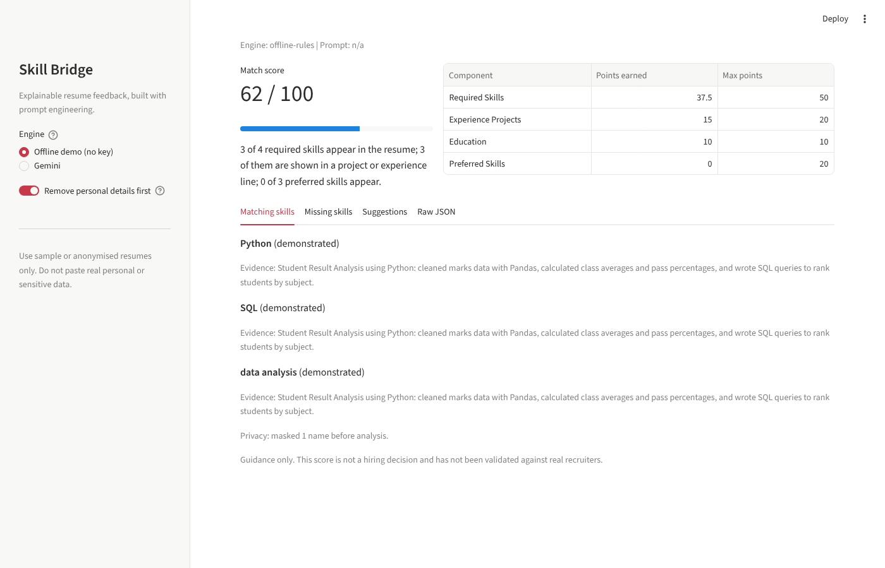
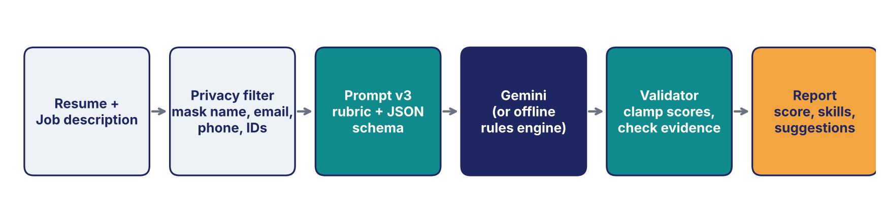
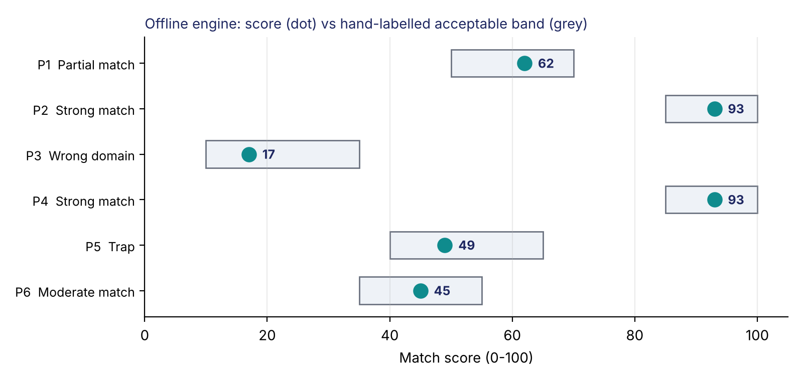

# AI Resume Analyzer and Job Matcher

> Paste a resume and a job description. Get a match score you can explain, the skills that are missing, and suggestions that never ask you to fake anything.

Built by **Team Skill Bridge** for *Prompt Engineering (SCSE4041)* at Bennett University. Problem source: Problem Pool **C9 - Resume Feedback Against a Job Description**.

**Live prototype:** (https://skill-bridge-resume-analyzer.streamlit.app) |  **Reel:** see the Milestone 2 form  |  [CHANGELOG](CHANGELOG.md)



## The problem in one paragraph
Students send the same resume to every job, then can't tell why they hear nothing back. Employers say they want *evidence* of skills - in NACE's Job Outlook 2025 survey, nearly 90% of responding employers looked for problem-solving evidence on student resumes - but a skill that is only named in a list proves very little. This tool compares a resume with a job description and shows, for each skill, whether it is **demonstrated**, **only listed**, or **missing**. Full write-up: [`docs/PROBLEM_STATEMENT.md`](docs/PROBLEM_STATEMENT.md).

## What it does
- **Explainable score (0-100)** from a fixed rubric: required skills 50, experience/projects 20, education 10, preferred skills 20.
- **Evidence for every match**: a quote from the resume, or the skill doesn't count.
- **"Listed only" detection**: a resume that lists eight skills and shows none scores *lower* than a shorter, honest one.
- **Honest suggestions**: "add this only if you really have it".
- **Privacy first**: names, emails, phone numbers, links and ID numbers are masked before anything is sent to an AI service.
- **Works offline**: a rule-based engine runs the whole app without an API key, for demos and tests.

## Quick start
```bash
git clone https://github.com/Gauri-Bansal15/skill-bridge.git
cd skill-bridge
python -m venv .venv && source .venv/bin/activate      # Windows: .venv\Scripts\activate
pip install -r requirements.txt
streamlit run app.py
```
The app opens in your browser with the **offline demo** engine. To use Gemini, get a key from [Google AI Studio](https://aistudio.google.com), then either paste it in the sidebar or:
```bash
cp .env.example .env     # then put your key in .env
export GEMINI_API_KEY=your-key
```
Command line:
```bash
python -m skillbridge.cli --resume data/resumes/aarav_mehta.txt --job data/jobs/ai_ml_intern.txt
python -m skillbridge.cli --resume data/resumes/aarav_mehta.txt --job data/jobs/ai_ml_intern.txt --engine gemini --prompt v3
```
A guided demo with screenshots and a 5-minute script is in [`docs/DEMO.md`](docs/DEMO.md).

## How it works


1. **Privacy filter** (`privacy.py`) masks personal details.
2. **Prompt** (`prompts/`) tells the model what to do, how to score, and what it must never do.
3. **Model** - Gemini, or the offline rules engine.
4. **Validator** (`scoring.py`) adds up the component scores itself (the model never does the maths), clamps out-of-range values, and moves any "match" whose quoted evidence isn't in the resume to *unverified*.
5. **Report** - score, breakdown, skills, suggestions, warnings.

## Prompt engineering
We went through three prompt versions. Each change has a reason; see [`prompts/CHANGELOG.md`](prompts/CHANGELOG.md).

| Version | Idea |
|---|---|
| **v1** baseline | Short and simple, free-text answer. |
| **v2** structured | Step-by-step instructions, strict JSON, evidence for every match. |
| **v3** rubric + guardrails | Four-part scoring rubric, "when unsure say unverified", ignore instructions hidden in the resume, no guessing from names. |

## Evaluation
`python evaluation/run_eval.py --engine offline` runs six labelled resume/job pairs. Details and metric definitions are in [`evaluation/README.md`](evaluation/README.md).



> **Read this honestly.** The offline engine hits every target, but the sample data is tiny, written by us, and uses the same skill list as the engine, so this is a *sanity check*, not proof of accuracy. The Gemini comparison of v1/v2/v3 is the real experiment and is run with `--engine gemini`. We have not claimed any Gemini numbers we have not measured.

## Repository layout
```
README.md                   this file
CHANGELOG.md                dated changes since Milestone 1
prompts/
  v1/ v2/ v3/               every prompt version (one file each)
  final/                    final prompt(s): P1_resume_analysis.md (identical to v3)
  CHANGELOG.md              why each prompt changed
code/                       pointer to the code (app.py, src/skillbridge/, tests/)
test-data/                  test_cases.json (12 tests), inputs/, outputs/ (real saved runs)
docs/                       Milestone 2 PDF, supporting document (BMC), diagrams, screenshots, report, slides
data/                       sample resumes and job descriptions used by the app
evaluation/                 run_tests.py, run_iteration_log.py, run_eval.py
scripts/                    make_diagrams.py, check_submission.py, contrib_stats.sh
```

## Tests
```bash
pip install -r requirements-dev.txt
python -m pytest -q
```

## Documents
| | |
|---|---|
| Report | [`docs/Skill_Bridge_Report.docx`](docs/Skill_Bridge_Report.docx) |
| Presentation | [`docs/Skill_Bridge_Presentation.pptx`](docs/Skill_Bridge_Presentation.pptx) |
| Problem statement | [`docs/PROBLEM_STATEMENT.md`](docs/PROBLEM_STATEMENT.md) |
| Demo guide | [`docs/DEMO.md`](docs/DEMO.md) |
| Individual contributions | [`docs/CONTRIBUTIONS.md`](docs/CONTRIBUTIONS.md) |

## Team
| Member | Role |
|---|---|
| Gauri Bansal (Team Leader) | Project lead, app, scoring, documentation |
| Garima Pandey | Prompt engineering, Gemini integration, offline engine, evaluation script |
| Bhumika Singh | Sample data, gold labels, running the evaluation |
| Shashank Choudhary | Privacy filter, tests, CI |

Details in [`docs/CONTRIBUTIONS.md`](docs/CONTRIBUTIONS.md).

## Limitations and responsible use
- The score is guidance for the student, **not a hiring decision**. Don't use it to screen people out.
- It reads text only: no PDF parsing, formatting checks or ATS simulation.
- The offline engine only knows the skills in `skills.py`; Gemini handles skills outside it.
- Language models can be inconsistent, so run important comparisons more than once.
- Use sample or anonymised resumes. Don't paste real personal or sensitive data into any AI tool.

## Licence
MIT - see [`LICENSE`](LICENSE).
