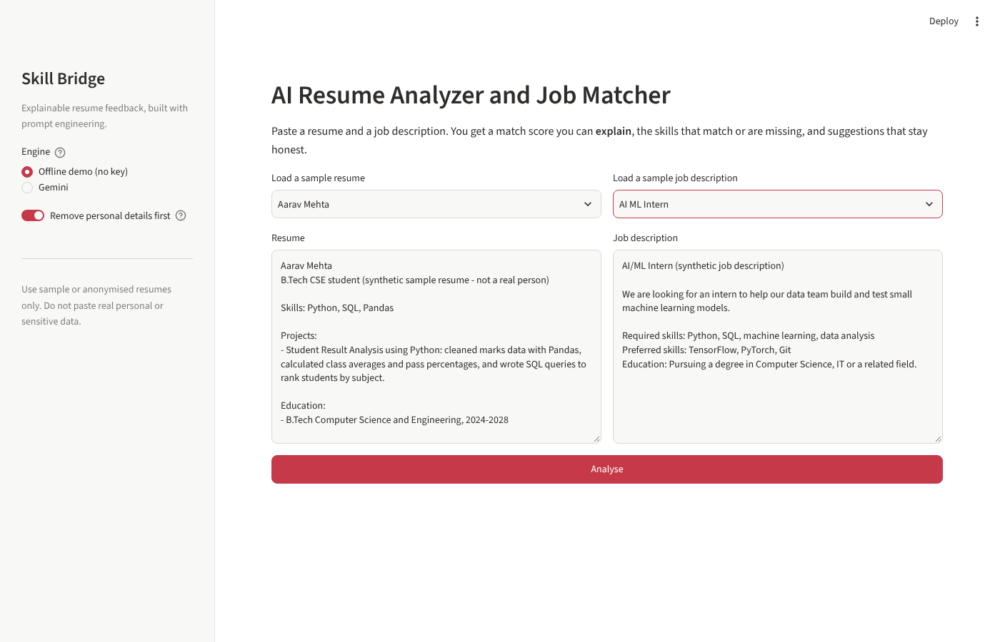
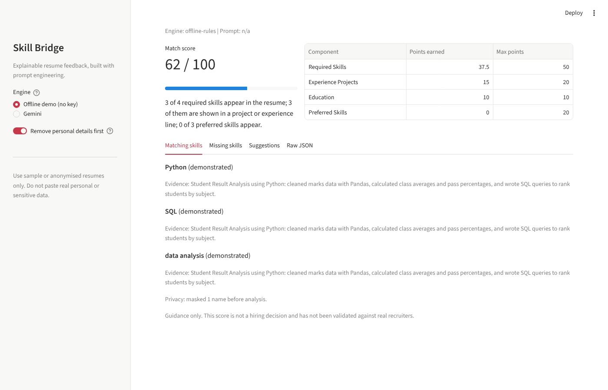
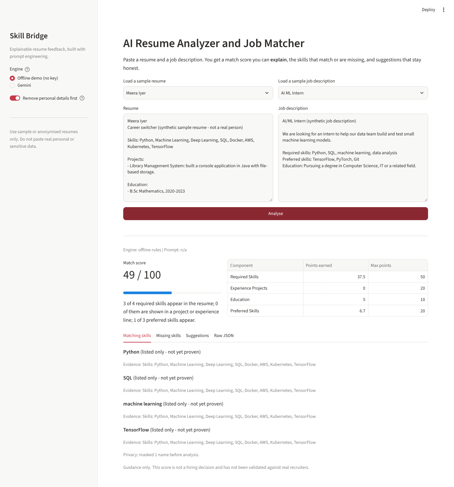

# Demo guide

There are three ways to see Skill Bridge working. All of them work **without an API key** using the offline engine; switch to Gemini in the sidebar when you have a key.

## 1. Web app (about 3 minutes)
```bash
pip install -r requirements.txt
streamlit run app.py
```
1. Pick **Aarav Mehta** as the sample resume and **AI ML Intern** as the job.
2. Click **Analyse**. You get 62/100, with a table showing where each point came from.
3. Open the **Missing skills** tab: machine learning is the one required skill that is missing.
4. Now load **Meera Iyer** with the same job. She *lists* more skills than Aarav, but scores lower (49) because none of them is shown in a project. This is the main idea of the project.
5. Tick **Gemini** in the sidebar, paste a key, and switch between prompt v1, v2 and v3 to compare.

### Screenshots (captured from the running app)
| Inputs | Result |
|---|---|
|  |  |

The "listed only" case:



## 2. Command line
```bash
python -m skillbridge.cli --resume data/resumes/aarav_mehta.txt --job data/jobs/ai_ml_intern.txt
```
Real output:
```text
$ python -m skillbridge.cli --resume data/resumes/aarav_mehta.txt --job data/jobs/ai_ml_intern.txt
Engine: offline-rules   Prompt: n/a

MATCH SCORE: 62/100
  required_skills      37.5
  experience_projects  15.0
  education            10
  preferred_skills     0.0
Why: 3 of 4 required skills appear in the resume; 3 of them are shown in a project or experience line; 0 of 3 preferred skills appear.

Matching skills:
  + Python (demonstrated)
  + SQL (demonstrated)
  + data analysis (demonstrated)
Missing skills:
  - machine learning [required]
  - TensorFlow [preferred]
  - PyTorch [preferred]
  - Git [preferred]
Suggestions:
  * [Skills / Projects] The job asks for machine learning. Add it only if you really have it; otherwise learn it and build a small project you can describe.

Guidance only. This score is not a hiring decision and has not been validated against real recruiters.
```

## 3. Evaluation run
```bash
python evaluation/run_eval.py --engine offline
```
Real output:
```text
ver  pair   score     band  inBand    F1  missR  unvR  valid
n/a  P1        62    50-70       1   1.0    1.0   1.0    1.0
n/a  P2        93   85-100       1   1.0    1.0   1.0    1.0
n/a  P3        17    10-35       1   1.0    1.0   1.0    1.0
n/a  P4        93   85-100       1   1.0    1.0   1.0    1.0
n/a  P5        49    40-65       1   1.0    1.0   1.0    1.0
n/a  P6        45    35-55       1   1.0    1.0   1.0    1.0

MEAN  in-band=1.00  match-F1=1.00  missing-recall=1.00  unverified-recall=1.00

Saved to evaluation/results/offline.csv
```

## Suggested 5-minute live demo script
| Time | What to show | What to say |
|---|---|---|
| 0:00 | Problem slide, then the app home page | "Students send one resume everywhere and can't see the gap." |
| 0:45 | Aarav + AI/ML Intern | "62/100. The table shows exactly where the points come from." |
| 1:45 | Missing skills tab | "Machine learning is the missing required skill. The suggestion says to add it only if true." |
| 2:30 | Meera + AI/ML Intern | "More skills on paper, lower score, because nothing is demonstrated." |
| 3:30 | Sidebar: switch prompt v1 / v3 (needs key) | "Same model, same resume. The prompt decides how useful the answer is." |
| 4:30 | Privacy line under the result | "Names, emails, phone numbers and IDs are masked before anything leaves the machine." |
